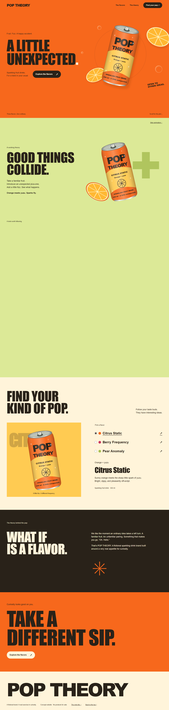

# POP THEORY

A playful, responsive concept website for a fictional sparkling fruit drink brand. The project explores a simple idea: familiar fruit combinations taking an unexpected turn.

**Demo only. No live website is published.** Open `index.html` locally, or follow the local preview instructions below.



## What this project demonstrates

- Original SVG product cans, labels, citrus slices, and CSS bubbles.
- Three working flavors: Citrus Static, Berry Frequency, and Pear Anomaly.
- A desktop scroll story with independently mapped introduction, collision, and resolution beats.
- Deliberate mobile composition with the story in normal reading flow.
- Native radio controls, keyboard focus, an accessible menu disclosure, skip control, reduced-motion support, and a no-JavaScript presentation.
- A static production build with no framework or runtime dependencies.

This is a fictional concept. No products are sold, and no health, award, or sustainability claims are made. The implementation was developed with AI assistance; it should be presented as an AI-assisted portfolio project.

## Run locally

Install Node.js, open a terminal in this folder, then run:

```sh
npm run dev
```

Open http://127.0.0.1:4389. No dependency installation is required.

```sh
npm run check
npm run build
```

The build copies the static production files into `dist/`. Any static host can serve that directory. GitHub Pages can also serve this repository's root directly.

## Edit the project

| File | Purpose |
| --- | --- |
| `index.html` | Semantic page sections, static copy, navigation, and no-JavaScript content |
| `content.js` | Flavor names, descriptions, colors, image references, and story beat configuration |
| `app.js` | Flavor selection, menu behavior, and scroll rendering |
| `style.css` | Shared design tokens, page layout, responsive composition, and motion fallbacks |
| `style-tile.html` | Lightweight style tile using the same CSS tokens |
| `assets/manifest.json` | Original vector asset dimensions, byte sizes, and provenance |
| `VERIFICATION.md` | Checks, evidence, and testing limits |

## Visual Story

| Scene | Visual story | Website copy |
| --- | --- | --- |
| Introduction | A tilted can and citrus slices introduce the product. | A little unexpected. |
| Transformation | The can turns and citrus moves outward as native scrolling advances. | Good things collide. |
| Resolution | The can settles; the page leads into the flavor selector. | Find your kind of pop. |

Desktop uses a 220svh story region with a sticky stage; the opening 25% holds before the main movement. Phones at 700px and below, screens 740px tall and below, reduced-motion mode, and JavaScript-disabled mode use normal document flow. Narrative copy remains real HTML. The SVG artwork is shared across all viewport sizes, so there is no portrait/landscape media-selection mismatch.

The narrow presentation is deliberately still. There is no wheel interception, scroll locking, generated footage, image sequence, paid generation, or external asset dependency. Animation only updates on scroll/resize and suspends rendering when the scene is outside the viewport or the tab is hidden.

## Media and licensing

All product artwork is original code-authored SVG supplied with the project. No external images, fonts, footage, or attribution-dependent assets are used. System fonts use Impact or Arial Narrow for headlines and Arial or Helvetica for body copy; exact glyphs can vary between operating systems.

All four original SVGs are also the production assets; vector artwork needs no raster conversion. Higgsfield generation was not used. Paid credits consumed: zero.

## Design choices

The loud poster direction uses orange, paper, dark ink, and lime fields. The palette was adapted to the citrus product rather than using the reference direction's blue palette. Product drawings replace photographic slots because there was no supplied photography and paid generation was excluded. Portrait-based reference sections were replaced with the actual brand introduction. Decorative motion is limited to the product story.

## Preview

- Open `style-tile.html` for the visual identity sheet.
- See `mobile.png` for the narrow-screen composition.
- See `verification.json` for the compact browser results.

No checkout, accounts, payments, mailing list, or backend are included.
